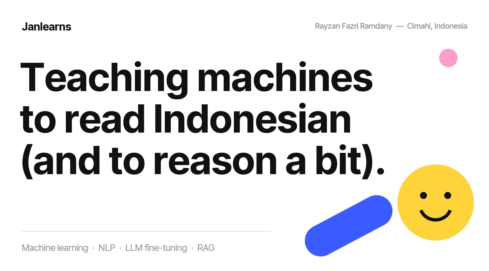
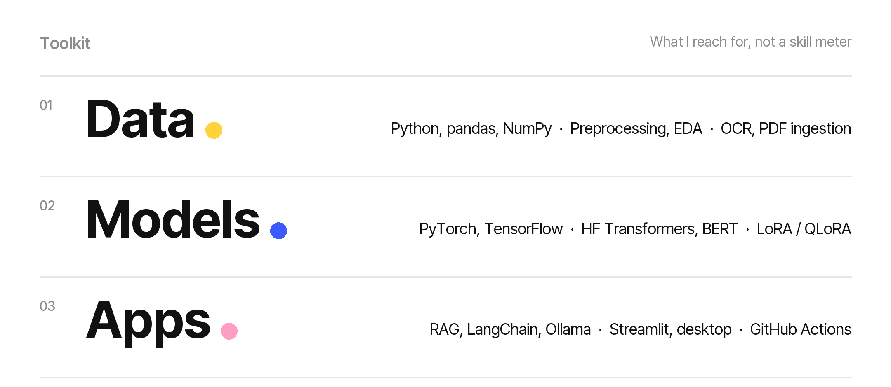
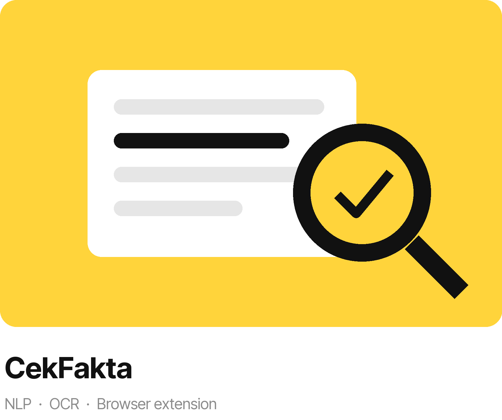
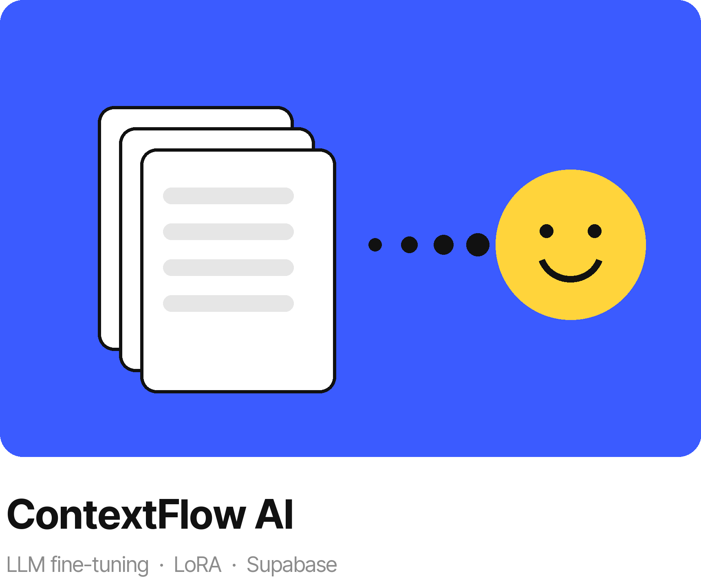
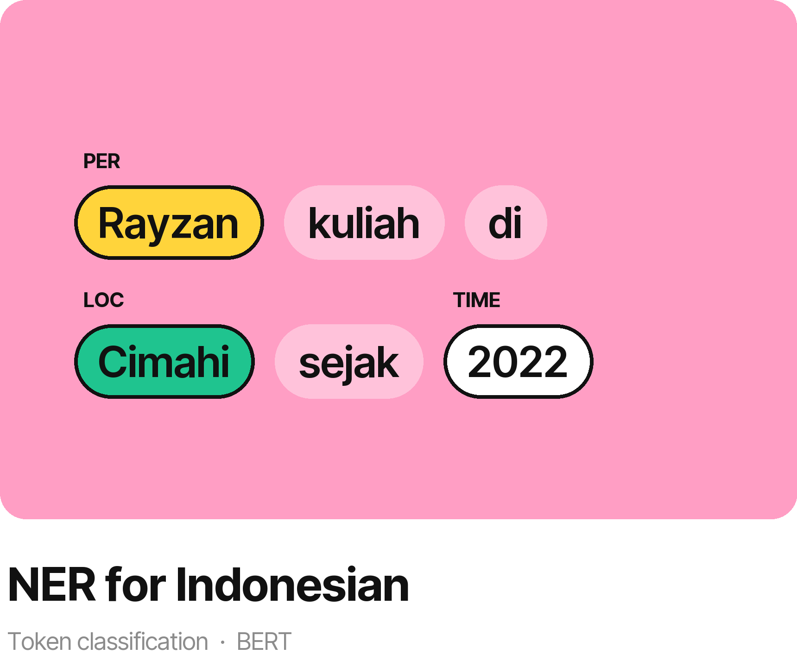
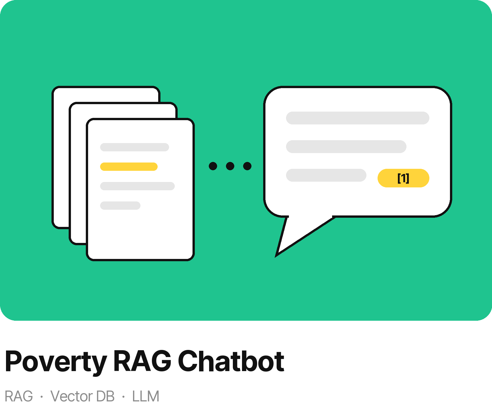
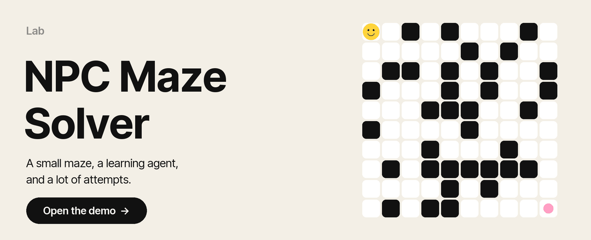
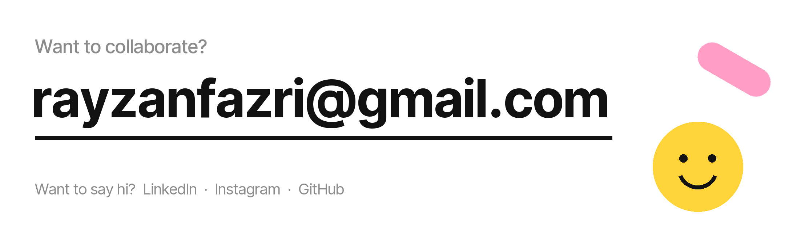



  <a href="#selected-work">Work</a> &nbsp;·&nbsp;
  <a href="https://janlearns.github.io/Portofolio/">Portfolio ↗</a> &nbsp;·&nbsp;
  <a href="https://www.linkedin.com/in/rayzan-fazri-ramdany-190063291">LinkedIn ↗</a> &nbsp;·&nbsp;
  <a href="https://www.instagram.com/rayzan3_0">Instagram ↗</a> &nbsp;·&nbsp;
  <a href="mailto:rayzanfazri@gmail.com">Email</a>

 

Hi, I'm Rayzan. Informatics student at [Universitas Jenderal Achmad Yani](https://www.unjani.ac.id/) and alumni of the Data Science & Machine Learning bootcamp at [dibimbing.id](https://dibimbing.id/). I build machine learning systems end to end, from cleaning the data to putting the model inside something people can actually click on.

**Right now:** fact-checking with transformers, LoRA fine-tuning on a budget GPU, and making RAG answers cite where they came from.

 

  

## Selected work

<table>
<tr>
<td width="50%" valign="top">

 
Paste a claim, get back the sources that support or contradict it. Searches the web, runs OCR on images, and checks claim–evidence pairs with a transformer. Ships as a Windows app and a browser extension. Still a prototype, and the README says so.
</td>
<td width="50%" valign="top">

 
An internal-knowledge assistant on TinyLlama 1.1B, fine-tuned with LoRA/QLoRA on SOP and HR-policy style documents. BLEU/ROUGE evaluation, chat logs in Supabase, CI with GitHub Actions.
</td>
</tr>
<tr>
<td width="50%" valign="top">

 
Fine-tunes <code>bert-base-multilingual-cased</code> to tag people, organizations, locations, time, and quantities in Indonesian sentences, trained on the <a href="https://github.com/indolem/indolem">IndoLEM</a> NER data.
</td>
<td width="50%" valign="top">

 
Answers questions about the socio-economic and environmental drivers of poverty in Indonesia. Retrieval is restricted to a curated set of academic papers, which keeps the model from making things up.
</td>
</tr>
</table>

Also on the bench: [a fashion stylist chatbot](https://github.com/Janlearns/Chatbot_outfit_langchain) (LangChain + Ollama over a PDF catalog) · [SmartSplit Bill AI](https://github.com/Janlearns/SmartSplit_Bill_AI) (Gemini reads a receipt and splits it) · [TokenScope](https://github.com/Janlearns/TokenScope) (token and context-window experiments on Groq)

**[View all projects →](https://github.com/Janlearns?tab=repositories)**

 

  <a href="https://janlearns.github.io/NPC_maze_project/"><b>Play with the demo ↗</b></a> &nbsp;·&nbsp;
  <a href="https://github.com/Janlearns/NPC_maze_project">Source code</a>

Take a look inside the application

 

 

## Commit history, eaten daily

<picture>
  <source media="(prefers-color-scheme: dark)" srcset="https://raw.githubusercontent.com/Janlearns/Janlearns/output/snake-dark.svg" />
  <source media="(prefers-color-scheme: light)" srcset="https://raw.githubusercontent.com/Janlearns/Janlearns/output/snake-light.svg" />
  
</picture>

Drawn from my real contribution graph by [Platane/snk](https://github.com/Platane/snk), redrawn twice a day by a GitHub Action in this repo.

  

Standing on these shoulders

 

Open work that my projects lean on directly:

- [Hugging Face Transformers](https://github.com/huggingface/transformers) and [PEFT](https://github.com/huggingface/peft): BERT fine-tuning and LoRA adapters
- [IndoLEM](https://github.com/indolem/indolem): Indonesian NER benchmark data
- [LangChain](https://github.com/langchain-ai/langchain) and [Ollama](https://github.com/ollama/ollama): local LLMs plus retrieval
- [TinyLlama](https://github.com/jzhang38/TinyLlama): a 1.1B model small enough to fine-tune on one GPU
- [Streamlit](https://github.com/streamlit/streamlit): the fastest way I know to put a model in front of someone

 

  <a href="mailto:rayzanfazri@gmail.com">Email</a> &nbsp;·&nbsp;
  <a href="https://www.linkedin.com/in/rayzan-fazri-ramdany-190063291">LinkedIn</a> &nbsp;·&nbsp;
  <a href="https://www.instagram.com/rayzan3_0">Instagram</a> &nbsp;·&nbsp;
  <a href="https://janlearns.github.io/Portofolio/">Portfolio</a> &nbsp;·&nbsp;
  <a href="#top">Back to top ↑</a>

Artwork generated by <a href="./scripts/build_profile.py">scripts/build_profile.py</a> · type set in <a href="https://fonts.google.com/specimen/Inter+Tight">Inter Tight</a>

