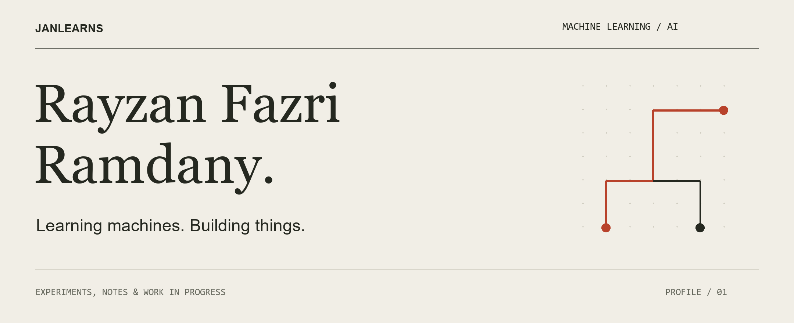
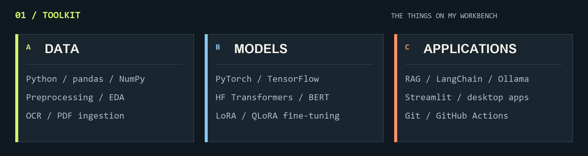
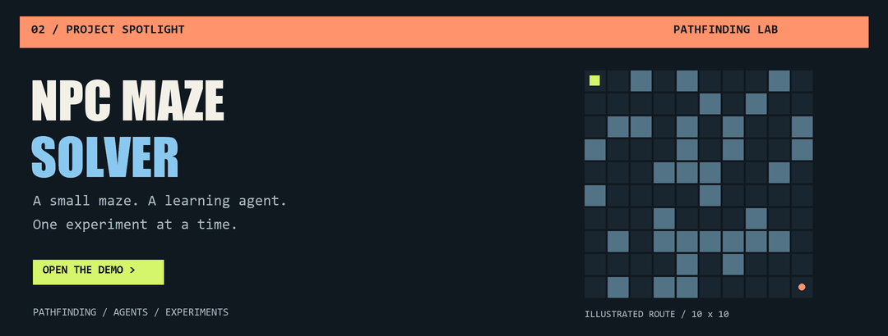
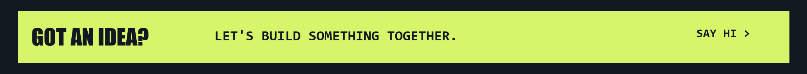



  <a href="https://janlearns.github.io/Portofolio/"><b>PORTFOLIO ↗</b></a> &nbsp; &nbsp; / &nbsp; &nbsp;
  <a href="mailto:rayzanfazri@gmail.com"><b>EMAIL ↗</b></a> &nbsp; &nbsp; / &nbsp; &nbsp;
  <a href="https://www.linkedin.com/in/rayzan-fazri-ramdany-190063291"><b>LINKEDIN ↗</b></a> &nbsp; &nbsp; / &nbsp; &nbsp;
  <a href="https://www.instagram.com/rayzan3_0"><b>INSTAGRAM ↗</b></a>

### Hey, I'm Rayzan 👋

Informatics student at [Universitas Jenderal Achmad Yani](https://www.unjani.ac.id/), Cimahi, and alumni of the Data Science & Machine Learning bootcamp at [dibimbing.id](https://dibimbing.id/). I build machine learning systems end to end, from cleaning the data to putting the model inside something people can actually click on. Lately most of that has been **NLP for Indonesian text, fine-tuning small LLMs, and retrieval-augmented apps**.

<table>
<tr>
<td width="50%" valign="top">

**↳ Currently exploring**

Fact-checking with transformers, LoRA fine-tuning on a budget GPU, and making RAG answers cite where they came from.

</td>
<td width="50%" valign="top">

**↳ Working toward**

Connecting the pieces: data → training → evaluation → a usable application.

</td>
</tr>
</table>

 

### Selected work

<table>
<tr>
<td width="50%" valign="top">

<code>NLP · OCR · BROWSER EXTENSION</code>

**[CekFakta ↗](https://github.com/Janlearns/Information-_detection)**

Paste a claim, get back the sources that support or contradict it. Searches the web, extracts articles, runs OCR on images, and checks claim–evidence pairs with a transformer. Ships as a Windows app and a browser extension. Still a prototype, and the README says so.

</td>
<td width="50%" valign="top">

<code>LLM FINE-TUNING · LORA · SUPABASE</code>

**[ContextFlow AI ↗](https://github.com/Janlearns/contextflow_ai_fine_tuning)**

An internal-knowledge assistant built on TinyLlama 1.1B, fine-tuned with LoRA/QLoRA on SOP and HR-policy style documents. Includes BLEU/ROUGE evaluation, chat logging in Supabase, and CI with GitHub Actions.

</td>
</tr>
<tr>
<td width="50%" valign="top">

<code>TOKEN CLASSIFICATION · BERT</code>

**[NER for Indonesian ↗](https://github.com/Janlearns/NER_indonesia)**

Fine-tunes `bert-base-multilingual-cased` to tag people, organizations, locations, time, and quantities in Indonesian sentences, using the [IndoLEM](https://github.com/indolem/indolem) NER data. Keeps the checkpoint with the best validation F1.

</td>
<td width="50%" valign="top">

<code>RAG · VECTOR DB · LLM</code>

**[Poverty RAG Chatbot ↗](https://github.com/Janlearns/RAG_untuk_tingkat_kemiskinan_di_indonesia)**

Answers questions about the socio-economic and environmental drivers of poverty in Indonesia. Retrieval is restricted to a curated set of academic papers, which keeps the model from making things up.

</td>
</tr>
</table>

Also on the bench: [a fashion stylist chatbot](https://github.com/Janlearns/Chatbot_outfit_langchain) (LangChain + Ollama over a PDF catalog) · [SmartSplit Bill AI](https://github.com/Janlearns/SmartSplit_Bill_AI) (Gemini reads a receipt and splits it) · [TokenScope](https://github.com/Janlearns/TokenScope) (token and context-window experiments on Groq) · [all repositories →](https://github.com/Janlearns?tab=repositories)

 

### A maze, an agent, and a lot of attempts.

**NPC Maze Solver** is a small environment for exploring how an agent learns to navigate. Start a run and follow its reward, step count, and progress across episodes.

**[▶ Play with the demo](https://janlearns.github.io/NPC_maze_project/)** &nbsp; &nbsp; **[↗ Source code](https://github.com/Janlearns/NPC_maze_project)**

<b>＋ Take a look inside the application</b>

 

 

### Commit history, eaten daily

<picture>
  <source media="(prefers-color-scheme: dark)" srcset="https://raw.githubusercontent.com/Janlearns/Janlearns/output/snake-dark.svg" />
  <source media="(prefers-color-scheme: light)" srcset="https://raw.githubusercontent.com/Janlearns/Janlearns/output/snake-light.svg" />
  
</picture>

Generated from my real contribution graph by [Platane/snk](https://github.com/Platane/snk), redrawn twice a day by a GitHub Action in this repo.

  

<b>＋ Standing on these shoulders</b>

 

Open work that my projects lean on directly:

- [Hugging Face Transformers](https://github.com/huggingface/transformers) and [PEFT](https://github.com/huggingface/peft): BERT fine-tuning and LoRA adapters
- [IndoLEM](https://github.com/indolem/indolem): Indonesian NER benchmark data
- [LangChain](https://github.com/langchain-ai/langchain) and [Ollama](https://github.com/ollama/ollama): local LLMs plus retrieval
- [TinyLlama](https://github.com/jzhang38/TinyLlama): a 1.1B model small enough to fine-tune on one GPU
- [Streamlit](https://github.com/streamlit/streamlit): the fastest way I know to put a model in front of someone

 

Open to conversations about AI, data science, and small projects worth trying.

